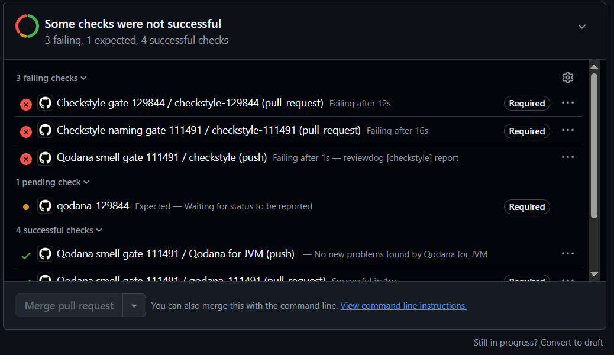

<!-- 111491 - Tomás Leal -->
# Quality gate Checkstyle: nomes de constantes (LEI-111491)

Ficha 3, Tarefa 2B. Aluno: Tomás Leal (111491).

## Ficheiros

| Ficheiro | Função |
|---|---|
| `checkstyle-111491.xml` | Configuração do Checkstyle só com a regra `ConstantName` (severidade `error`). |
| `.github/workflows/checkstyle-111491.yaml` | Workflow do GitHub Actions (job/check `checkstyle-111491`), corre em `pull_request` com a action [`dbelyaev/action-checkstyle@v4.5.0`](https://github.com/dbelyaev/action-checkstyle) (Checkstyle 14.4.0 + reviewdog). |

## Convenção escolhida

Identificadores do tipo **constante** (campos `static final`), regra **`ConstantName`** com o padrão `^[A-Z][A-Z0-9]*(_[A-Z0-9]+)*$`: só maiúsculas, dígitos e palavras separadas por `_` (ex.: `MAX_SHIPS`, `FILE_PATH`), como nas convenções da Oracle e da Google.

Configuração da action (verificada no `action.yml` oficial):

- `fail_level: error`: o valor por omissão é `none`, com o qual o job nunca falha.
- `level: error` e `reporter: github-pr-check`: as violações aparecem como anotações no PR, com ficheiro e linha.
- `filter_mode: added`: só são reportadas violações em linhas adicionadas pelo PR, para o gate não bloquear PRs por código que já existia.

## Provocar a violação (passo 4)

PR [#19](https://github.com/LEI-129844/Battleship2/pull/19) (não integrado no `main`):

- **Execução que falha:** constante `maxShips` em `ScoreboardManager.java`, linha 18 (*"Name 'maxShips' must match pattern '^[A-Z][A-Z0-9]*(_[A-Z0-9]+)*$'"*): <https://github.com/LEI-129844/Battleship2/actions/runs/42496706259>
- **Execução que passa:** nome corrigido para `MAX_SHIPS`: <https://github.com/LEI-129844/Battleship2/actions/runs/42498413703>

## Impedir o merge (passo 5)

Foi configurado no `main` um *ruleset* (*Require status checks to pass*) que exige os checks dos quality gates do grupo, entre eles o `checkstyle-111491`. Como só o administrador do repositório (LEI-129844) tem acesso às definições, foi ele que o configurou, e o ruleset foi ativado temporariamente para estes testes.

Com a constante `maxShips` reintroduzida no PR [#19](https://github.com/LEI-129844/Battleship2/pull/19), o check `checkstyle-111491` falhou ([execução](https://github.com/LEI-129844/Battleship2/actions/runs/42503320749)) e o botão de merge ficou bloqueado:

## O que o Checkstyle não consegue verificar

O Checkstyle só verifica a forma do nome (maiúsculas, dígitos e `_`), não se o nome é significativo: `MAX_SHIPS`, `X1` ou `VALOR_TEMP` passam todos, mesmo que só o primeiro explique o que a constante representa. Também não deteta nomes enganadores (uma constante `MAX_SHIPS = 5` quando a frota tem outro tamanho), mistura de línguas (`FILE_PATH` ao lado de `carregarScores`) ou valores que deviam ser constantes e não o são. Por fim, com `filter_mode: added`, a violação que já existia no projeto (`gson` em `ScoreboardManager.java`, linha 14) não é reportada, porque não está em linhas alteradas pelo PR.
