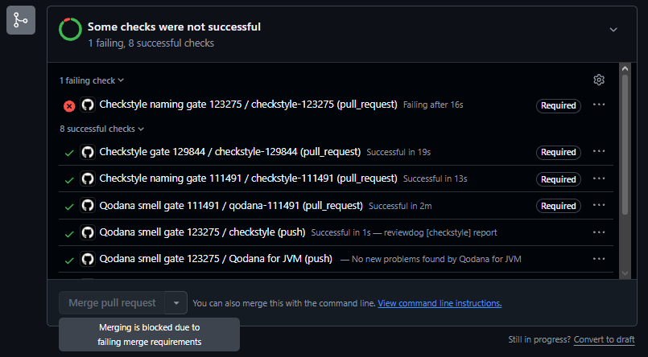

<!-- 123275 - Gonçalo Silva -->
# Checkstyle: gate para nomes de atributos (LEI-123275)

Ficha 3, Tarefa 2B. Gonçalo Silva, nº 123275.

## O que foi feito

Escolhi os **atributos**, isto é, os campos de instância (não estáticos). Para eles usei a regra `MemberName`, com o padrão `^[a-z][a-zA-Z0-9]*$`: o nome começa por minúscula e segue camelCase, como em `numeroTiros`.

- `checkstyle-123275.xml`: configuração do Checkstyle só com `MemberName`, com severidade `error`.
- `.github/workflows/checkstyle-123275.yaml`: workflow que corre em cada pull request, com o job `checkstyle-123275`, usando a action [`dbelyaev/action-checkstyle@v4.5.0`](https://github.com/dbelyaev/action-checkstyle).

Na action, `fail_level: error` é o que faz o job falhar quando há violações (sem ele a action nunca falha), `reporter: github-pr-check` coloca os resultados no PR e `filter_mode: added` limita a análise às linhas que o PR acrescenta.

## Execuções do gate (passo 4)

PR [#27](https://github.com/LEI-129844/Battleship2/pull/27), ramo `123275-provoca-membername`, que nunca foi integrado no `main`.

- **Falha.** Declarei `private int Numero_Tiros;` na classe `MemberNameViolation`, linha 9 do ficheiro, que não cumpre o padrão. Execução: <https://github.com/LEI-129844/Battleship2/actions/runs/42520718651/job/128853376536>
- **Passa.** Renomeei o atributo para `numeroTiros`. Execução: <https://github.com/LEI-129844/Battleship2/actions/runs/42521667161/job/128856291164>

## Bloqueio do merge (passo 5)

O ruleset do `main`, criado pelo dono do repositório (LEI-129844), exige o check `checkstyle-123275`. Com `Numero_Tiros` no PR #27 o check ficou vermelho e o GitHub bloqueou o botão de merge ("Merging is blocked due to failing merge requirements"):

## Limitações do Checkstyle

A regra olha só para a forma do nome. `numeroTiros`, `x1` e `tmp` passam todos, por isso não avalia se o nome é significativo, e também não apanha um nome que engane (um `numeroTiros` que conta acertos) nem a mistura de português e inglês. A `MemberName` também só se aplica a atributos de instância: constantes, parâmetros e variáveis locais precisam das regras `ConstantName`, `ParameterName` e `LocalVariableName`. Com `filter_mode: added`, os nomes que já estavam mal antes do PR não são reportados.
