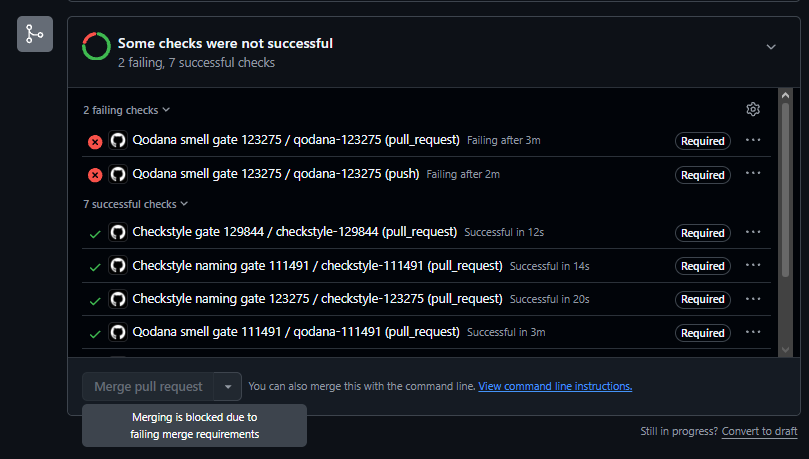

<!-- 123275 - Gonçalo Silva -->
# Qodana: gate para o cheiro Large Class (LEI-123275)

Ficha 3, Tarefa 2A. Gonçalo Silva, nº 123275.

## Visão geral

Escolhi detetar **Large Class**. No livro de Lanza e Marinescu o equivalente é a *God Class*, que junta complexidade alta (WMC), muito acesso a dados de outras classes (ATFD) e pouca coesão (TCC). O Qodana não oferece essa combinação, por isso o gate aproxima-a com duas inspeções da categoria *Java > Class metrics*, uma sobre o número de métodos e outra sobre a complexidade total da classe.

Ficheiros entregues:

- `qodana-123275.yaml`: linter `qodana-jvm-community:2026.2`, JDK 21, falha se existir qualquer problema (`any: 0`) e exclui `src/test` das duas inspeções.
- `.qodana/profiles/profile-123275.yaml`: perfil que parte de `empty` e só ativa `MethodCount` e `ClassComplexity`.
- `.github/workflows/qodana-smell-123275.yaml`: workflow com o job `qodana-123275`, que analisa o projeto inteiro (`pr-mode: false`) em PRs, em pushes para `main` e para ramos `123275-*`.

## Mapeamento Fowler para Qodana (passo 4)

| Cheiro | Inspeção no IDE | ID no perfil | Métrica e limiar | O que não consegue expressar |
|---|---|---|---|---|
| Large Class | Class with too many methods | `MethodCount` (para `@SuppressWarnings`: `ClassWithTooManyMethods`) | NOM; `m_limit` por omissão 20, aqui 25 | Limiar absoluto e igual para todo o sistema; os getters e setters contam (a opção `ignoreGettersAndSetters` está desligada). |
| Large Class | Overly complex class | `ClassComplexity` (para `@SuppressWarnings`: `OverlyComplexClass`) | WMC, a soma da CC dos métodos declarados; `m_limit` por omissão 80, aqui 80 | Ignora os métodos herdados e não cruza a complexidade com mais nada. |
| God Class (livro) | sem equivalente | | ATFD e TCC | Não há inspeção para estas duas métricas, logo não dá para exigir WMC alto, ATFD alto e TCC baixo ao mesmo tempo. |

Os IDs e as opções foram confirmados nas páginas do Inspectopedia de cada inspeção. No perfil usa-se o ID que o IDE mostra nas definições; o outro serve só para suprimir avisos no código.

## Porquê estes limiares

- **25 métodos.** A Tabela 2 do guião põe o patamar "muito alto" de NOM em 15, mas esse valor é relativo a um conjunto de sistemas. Para o gate ficar verde no código existente parti do maior caso de produção: a classe `Game` tem 23 métodos e WMC 67 (MetricsTree, commit `a0dc401`). Com 25 há folga e o gate continua a apanhar classes claramente maiores.
- **80 de complexidade.** É o valor por omissão da inspeção, acima dos 67 do `Game`.
- **Testes fora.** Logo no primeiro run, no PR de entrega (#26), falhou o `PositionTest`, com 26 métodos contra o limite de 25. É uma classe de testes, com muitos métodos pequenos e independentes, e não o problema que o gate procura. Por isso `src/test` foi excluído das duas inspeções.

## Execuções do gate (passo 9)

PR [#28](https://github.com/LEI-129844/Battleship2/pull/28), ramo `123275-provoca-largeclass`, que nunca foi integrado no `main`.

- **Falha.** Acrescentei `LargeClassSmell`, com 30 métodos. O Qodana assinalou `LargeClassSmell.java`, linha 7: *"`LargeClassSmell` has too many methods (method count = 30)"*. Execução: <https://github.com/LEI-129844/Battleship2/actions/runs/42520773017/job/128853540074>
- **Passa.** Reduzi a classe para 20 métodos. Execução: <https://github.com/LEI-129844/Battleship2/actions/runs/42521964174/job/128857203194>

## Bloqueio do merge (passo 10)

O dono do repositório (LEI-129844) criou um ruleset no `main` com a regra *Require status checks to pass*, onde incluiu o check `qodana-123275`. Quando o PR #28 tinha a classe com 30 métodos, esse check ficou vermelho ([execução](https://github.com/LEI-129844/Battleship2/actions/runs/42520773017/job/128853540074)) e o GitHub desativou o botão de merge com a mensagem "Merging is blocked due to failing merge requirements":

## Reflexão

No `main` o gate só assinalou o `PositionTest` (26 métodos para um limite de 25), que é um falso positivo: uma classe de testes não é uma Large Class. O mesmo risco existe para classes cheias de getters e setters, que a inspeção conta como métodos normais. Os falsos negativos vêm de a medida ser só o número de métodos ou a complexidade somada: uma classe com poucos métodos, mas muitos atributos e responsabilidades, passa sempre, e o livro exige ainda ATFD alto e TCC baixo, que o Qodana não mede. O resultado depende muito do limiar, pois bastou um método a mais do que o limite (26 contra 25) para o gate falhar, e um limiar absoluto não reflete o tamanho relativo da classe no sistema, ao contrário dos valores do livro.
